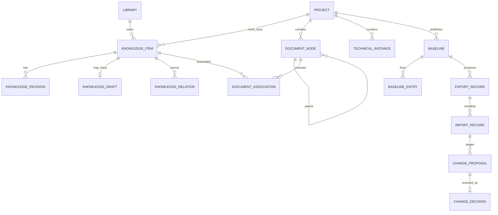

# Modelo conceptual de dados

## Entidades nucleares

### Workspace
Configuração local, utilizador de proveniência, políticas de backup e caminhos.

### Library
Biblioteca EDA versionada.

### Project
Projeto específico criado a partir de um modelo.

### ProjectTemplate / ProjectTemplateVersion
Modelo versionado de estrutura, princípios e perfis.

### KnowledgeItem
Identidade lógica permanente da unidade.

### KnowledgeRevision
Conteúdo imutável de cada revisão concluída.

### KnowledgeDraft
Rascunho automático, mutável e separado da revisão.

### TechnicalProfile
Extensão opcional de uma unidade. Subtipos MVP: control_function, interface, requirement, decision, open_question.

### RelationType / KnowledgeRelation
Vocabulário extensível e relações versionadas.

### DocumentNode
Árvore documental genérica com parent_id e node_type.

### DocumentAssociation
Associação qualificada entre KnowledgeItem e DocumentNode.

### SystemClass / EquipmentClass / FunctionClass
Catálogo reutilizável.

### TechnicalInstance
Instâncias de sistemas, equipamentos e funções no projeto.

### Reference / StandardProfile
Referência genérica e extensão normativa opcional.

### TerminologyConcept
Vocabulário controlado.

### ApplicabilityRule / ProjectDisposition
Aplicabilidade e decisão de inclusão/exclusão.

### AuthoringProfile / AuthoringProfileVersion
Instruções base, de projeto e de fascículo.

### Baseline / BaselineEntry
Snapshot lógico imutável das versões aprovadas.

### ExportRecord
Manifesto de cada exportação, hash, perfil e ficheiros.

### ImportRecord / ImportStagingItem
Ficheiro devolvido, validação, quarentena e propostas.

### ChangeProposal / ChangeDecision
Diferenças agrupadas e decisão humana.

### BackupRecord
Metadados dos backups locais.

## Invariantes essenciais

1. KnowledgeItem.id é UUID imutável.
2. KnowledgeRevision é append-only.
3. Uma revisão concluída nunca é editada.
4. Uma baseline é imutável após publicação.
5. Um código documental pertence a uma baseline/versão de trabalho, não à identidade do nó.
6. Omissão num pacote importado não cria ChangeProposal de remoção.
7. Aprovação e ciclo de vida nunca são aceites diretamente do JSON devolvido.
8. O conhecimento de biblioteca referenciado por projeto é fixado por revisão.
9. Fusões preservam aliases e objetos substituídos.
10. Exportações preservadas referenciam versões exatas.
11. Relações de dependência não podem ser autorreferenciais; ciclos são sinalizados.
12. Exclusões são disposições explícitas, não ausência de associação.

## Diagrama conceptual simplificado

## Orientação relacional

Usar colunas relacionais para identidade, estados, âmbitos, versões, relações e campos usados em filtros. Usar JSON apenas para payloads de fichas opcionais, manifests imutáveis, relatórios de validação e dados de migração cuja consulta relacional não seja necessária. Não guardar a unidade inteira num único blob JSON.
