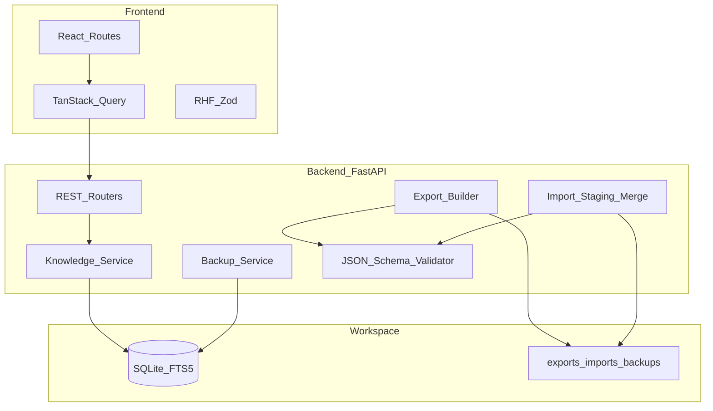
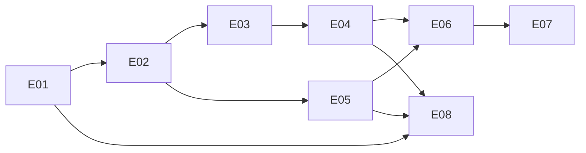

# Plano de implementação — GET Gerador de Especificações Funcionais (v2)

**Entrega desta fase (após aprovação):** materializar [`docs/PLAN.md`](docs/PLAN.md) e [`docs/PLAN_REVIEW_CHECKLIST.md`](docs/PLAN_REVIEW_CHECKLIST.md) no repositório — **sem código de produção** até **"Plano aprovado. Implementa a Fase 1."**

**Estado das fontes:** as 12 fontes obrigatórias foram lidas (uploads atuais). O repo contém cópias parciais; falta sincronizar `docs/DATA_MODEL.md`, `schemas/`, `examples/` e alinhar `.cursor/rules/get-knowledge-studio.mdc` ao pacote canónico antes da implementação.

---

## Conflitos e tensões assinalados (não resolvidos silenciosamente)

| ID | Fontes | Descrição | Tratamento no plano (precedência ADR > spec > schema > backlog > exemplo) |
|----|--------|-----------|------------------------------------------------------------------------|
| **C-01** | ADR-045 vs `fascicle-roundtrip.example.json` | `technical_instances[].instance_id` usa código legível (`SYS-FUEL-FEEDERS`), não UUID. | SQLite: `technical_instance.id` UUID; exportação serializa `instance_id` conforme exemplo; documentar mapeamento no exportador; não alterar exemplo no MVP sem bump de `schema_version`. |
| **C-02** | ADR-045 vs exemplo | Terminologia com `concept_id: "TERM-001"`. | Mesma estratégia: UUID interno + código exportado. |
| **C-03** | ADR-004 / spec §5 vs `knowledge-item.schema.json` | Captura mínima exige **contexto**; schema export não tem campo `context`. | Coluna relacional `origin_context` obrigatória na BD; na exportação mapear para `content`/`notes` ou extensão acordada sem mudar schema v1.0.0. |
| **C-04** | DATA_MODEL inv.7 vs schema | Estados `approval`/`lifecycle` aparecem no JSON exportado. | Export inclui estados atuais como leitura; **reimportação ignora alterações directas** a `states.approval` e `states.lifecycle` (e `provenance`); mudanças de maturidade exigem aprovação explícita na UI (como qualquer outro campo protegido). Alinha com `edit_policy.protected_fields` do exemplo. |
| **C-05** | `master.schema.json` vs E06 | `document_structure`, `knowledge_index`, etc. são `array` de `object` genérico. | Schema top-level é intencionalmente permissivo; validação adicional no **builder de exportação** (contratos Pydantic internos espelhando a forma dos exemplos) + testes golden contra `master.example.json` e `fascicle-roundtrip.example.json`. |
| **C-06** | Spec §18 vs exemplo | Spec lista "versão de origem" como protegida; exemplo usa `revision` + `protected_fields`. | Merge trata `revision` e `id` como protegidos; `base_revision` do pacote fascículo ancora comparação estrutural. |

**Sem conflito material** entre README, ADRs, especificação e backlog.

**Questão bloqueante restante (só E08):** caminho e estrutura do workbook GET existente — não impede E01–E07.

---

## 1. Resumo executivo

Aplicação web **local**, **127.0.0.1**, **SQLite+FTS5** como fonte de verdade. Gestão de **Biblioteca EDA** e **Projetos** com árvores documental e técnica e unidades de conhecimento versionadas. **Exportação determinística** (`get_project_master`, `get_fascicle_roundtrip`) e **reimportação** via staging com validação JSON Schema, quarentena, **three-way merge** (base exportada / actual / devolvido) e **aprovação por unidade**. Contratos alinhados a [`schemas/`](schemas/) e exemplos em [`examples/`](examples/). Stack: FastAPI + SQLAlchemy 2 + Alembic; React + Vite + TanStack Query + RHF + Zod. Sem LLM, Word, cloud, auth, embeddings, Docker.

---

## 2. Pressupostos e não objetivos

**Pressupostos:** workspace de dados separado do código; utilizador local só para proveniência; `schema_version` inicial **1.0.0**; perfis Discussão/Redação sobre a mesma baseline; IDs temporários `new_001` no roundtrip resolvidos na consolidação.

**Não objetivos:** conforme especificação §26 e regras em [`get-knowledge-studio.mdc`](.cursor/rules/get-knowledge-studio.mdc).

---

## 3. Inventário de requisitos

### Funcionais (mapeados ao backlog)

WF-01→E01 workspace/backups/migrações; WF-02→E02 biblioteca e conhecimento; WF-03→E03 projetos/modelos; WF-04→E04 documental; WF-05→E03-S02 técnico; WF-06 vistas coordenadas (E04+E03 UI); WF-07→E05 fichas; WF-08 terminologia/referências E05; WF-09 perfis (E05/E06); WF-10 baselines E04/E06; WF-11 export E06; WF-12 import E07; WF-13 search E02; WF-14 backups E01; WF-15 migração E08.

### Não funcionais

NF-01 determinismo export (ordenação estável alinhada a `fascicle-roundtrip` e mestre); NF-02 ACID + revisões append-only; NF-03 conteúdo importado não confiável + Markdown sanitizado; NF-04 backups pré-import; NF-05 offline; NF-06 testes contrato com exemplos; NF-07 migrações Alembic reversíveis.

---

## 4. Arquitectura de alto nível



Um processo backend em `127.0.0.1`; frontend Vite com proxy em desenvolvimento.

---

## 5. Módulos backend

| Módulo | Função |
|--------|--------|
| `workspace` | Paths, config, utilizador proveniência |
| `db` | Engine WAL, `foreign_keys=ON`, sessões |
| `models` | Entidades [`docs/DATA_MODEL.md`](docs/DATA_MODEL.md) |
| `knowledge` | Item, draft, revision, estados, aliases |
| `library` | Library versionada |
| `projects` | Project, template version, library pin |
| `document` | DocumentNode, numeração, DocumentAssociation |
| `technical` | Classes, TechnicalInstance |
| `relations` | RelationType, KnowledgeRelation |
| `references` / `terminology` | Reference, StandardProfile, TerminologyConcept |
| `profiles` | AuthoringProfileVersion |
| `baseline` | Baseline, BaselineEntry imutáveis |
| `export` | Master + fascicle + MD + ZIP; `validation` block |
| `import_flow` | ImportRecord, staging, quarantine, merge, ChangeProposal/Decision |
| `search` | FTS5 |
| `backup` | Política retenção spec §24 |
| `security` | Sanitize markdown, limites JSON |
| `schemas_pkg` | Resolução `$ref` common/knowledge-item |

---

## 6. Módulos frontend

Shell Biblioteca/Projetos; wizard workspace (E01); editor conhecimento (draft/revision); árvores documental/técnica; painel vistas coordenadas; export wizard (perfil Discussão/Redação); import review (diff 3-vias, quarentena, batch sem conflitos); baselines; backups; search.

---

## 7. Modelo de dados lógico, tabelas e invariantes

Seguir entidades em [`docs/DATA_MODEL.md`](docs/DATA_MODEL.md). Mapeamento físico proposto (SQLite):

**E01 — fundações**

- `workspace_settings` (id, root_path, created_at, local_user_name, schema_versions_json **só metadata**, retention policy)
- `backup_record` (id, tier: critical/daily/weekly, path, sha256, created_at, preview_meta_json, user_note opcional)

**E02 — conhecimento**

- `library` + `library_version` (version int, published_at)
- `knowledge_item` (uuid PK, scope_type library|project, scope_id FK, human_code, created_at)
- `knowledge_item_alias` (item_id, alias, unique)
- `knowledge_draft` (item_id UNIQUE, title, content_md, origin_context, …, updated_at)
- `knowledge_revision` (id, item_id, revision_num UNIQUE per item, **append-only**, states columns, title, content_md, origin_context, knowledge_type, provenance columns)
- `knowledge_revision_fts` (FTS5 content=...)
- `relation_type` + `knowledge_relation` (CHECK source != target)
- `technical_profile_payload` (revision_id FK, profile_type enum, **data_json** — texto livre MVP)

**E03–E05** — `project`, `project_template_version`, `project_library_pin`, classes, `technical_instance` (uuid PK + export_code), `reference`, `standard_profile`, `terminology_concept`, `document_node`, `document_association` (qualified role, sort_order, pinned_revision_id FK)

**E06–E07** — `baseline`, `baseline_entry` (entity_type, entity_id, revision_num frozen), `baseline_document_code`, `export_record` (export_id, profile, schema_name, sha256, baseline_id, file_path), `import_record`, `import_staging_item`, `import_quarantine_item`, `merge_session` (base_export_id), `change_proposal`, `change_decision`

**Invariantes (DATA_MODEL + regras):** itens 1–12 do DATA_MODEL; merge nunca cria remoção por omissão (`working_instructions.treat_omissions_as_deletions: false`); remoções só via `proposed_removals` ou `change_summary` tipo `removal_proposed`.

**JSON vs relacional:** conforme DATA_MODEL — relacional para identidade, estados, relações, pins; JSON apenas para `technical_profile.data`, manifests de baseline/export audit, relatórios validação, raw import preservado em staging.

**Índices chave:** `(knowledge_item.scope_type, scope_id)`, `(document_node.project_id, parent_id, sort_key)`, `(knowledge_revision.item_id, revision_num)`, FTS; UNIQUE parcial em códigos por âmbito.

**Transacções:** baseline publish, import consolidate, reordenação árvore — cada uma numa transacção; backup crítico **antes** de import ou DDL estrutural.

---

## 8. Revisões, baselines e numeração

- **Draft:** autosave mutável; nunca referenciado em export Redação; Discussão opcional.
- **Revision:** `POST conclude` copia draft → nova linha `knowledge_revision`; imutável.
- **Baseline:** transacção cria `baseline` + entradas para cada revisão activa, library version pin, snapshot `document_node` codes em `baseline_document_code`, perfis e schema versions.
- **Numeração viva:** DFS por `sort_key`; `display_code` derivado; relatório ao mover; congelamento na baseline (ADR-022).

---

## 9. Exportação, reimportação e three-way merge

### Exportação

1. Seleccionar conjunto por baseline ou working + `export_profile` (`discussion` | `redaction`).
2. Montar pacote conforme `master.schema.json` ou `fascicle-roundtrip.schema.json`.
3. Preencher `edit_policy` por item (como exemplo: protected `id`, `revision`, `states.approval`, `states.lifecycle`, `provenance`).
4. Incluir `working_instructions` com constantes do schema.
5. Serialização determinística: chaves ordenadas; arrays por `id`/`position`; timestamps ISO8601.
6. Validar com jsonschema; gravar `export_record` + ficheiro; calcular hash para `fascicle_manifest.content_hash`.

### Reimportação (spec §19)

Staging → parse → schema_version (rejeitar futura) → quarentena unidades inválidas → carregar **B** do `export_record` ligado → **C** materializado → **D** devolvido.

**Merge por unidade** (`knowledge-item` UUID):

- Novos IDs ou prefixos `new_*` → propostas.
- Ausência em D → sem acção (C-04/C-06 + schema `treat_omissions_as_deletions: false`).
- `proposed_removals` / `change_summary.removal_proposed` → proposta explícita.
- Campos em `protected_fields`: conflito ou confirmação obrigatória; **nunca** aplicar `approval`/`lifecycle` do JSON (DATA_MODEL inv.7).
- Estrutura fascículo: nós por UUID em `fascicle.structure`; propostas `structure_proposed` (ADR-006).
- Consolidação: novas `knowledge_revision`; `ChangeDecision` com destino project/library/pending (ADR-012).

---

## 10. Segurança local

Bind `127.0.0.1`; sanitização Markdown (sem HTML cru); validação schema estrita; limites tamanho/profundidade JSON; sem fetch de URLs do conteúdo importado; CSP frontend.

---

## 11. Backup e restauro

`sqlite3` backup API / `VACUUM INTO`; tiers 10/14/8; crítico automático pré-import e pré-DDL estrutural; restauro com pré-visualização (contagens); export workspace ZIP.

---

## 12. Migração workbook inicial

`scripts/migrate_workbook_get.py` (openpyxl) → relatório + staging; templates XLSX só gerados pela app (E08-S02); consolidação manual.

---

## 13. Fases e dependências

| Fase | Épico | Foco |
|------|-------|------|
| 1 | E01 | Monorepo, workspace, Alembic v1, backups, health, bind test |
| 2 | E02 | Conhecimento, library, FTS, relações, duplicados |
| 3 | E03 | Templates, projetos, técnico |
| 4 | E04 | Árvore documental, numeração, associações |
| 5 | E05 | Fichas, referências, terminologia |
| 6 | E06 | Export + testes contrato exemplos (incl. glossário `terminology_*_llm.md` no pacote GET-LLM — ver [GET_MACRO_PLAN.md](GET_MACRO_PLAN.md) e [micro-F2-terminology-llm-export.md](plans/micro-F2-terminology-llm-export.md)) |
| 7 | E07 | Import, merge, aprovação, testes falha |
| 8 | E08 | Workbook + templates Excel |



---

## 14. Ficheiros e diretórios

```
README.md, ARCHITECTURE_DECISIONS.json, BACKLOG.json, MANIFEST.json
.cursor/rules/get-knowledge-studio.mdc
docs/GET_APP_SPECIFICATION.md, DATA_MODEL.md, IMPLEMENTATION_PLAN_TEMPLATE.md,
     PLAN.md, PLAN_REVIEW_CHECKLIST.md
schemas/{common,knowledge-item,master,fascicle-roundtrip}.schema.json
examples/{master,fascicle-roundtrip}.example.json
backend/{pyproject.toml, alembic/, app/..., tests/unit,integration,contract}
frontend/{package.json, vite.config.ts, src/...}
scripts/{run_local.sh, migrate_workbook_get.py}
e2e/playwright/
```

**Pré-implementação:** copiar uploads canónicos para estes paths (repo actual incompleto).

---

## 15. Plano de testes por fase

| Fase | pytest | Vitest | Playwright |
|------|--------|--------|------------|
| 1 | localhost bind, alembic up/down, backup restore | workspace smoke | abrir/criar workspace |
| 2 | draft/revision immutability, FTS, relation cycle | editor autosave | criar unidade |
| 6 | `examples/*.json` validam; determinismo hash; master+fascicle round-trip builder | export UI | export file |
| 7 | truncado, schema futuro, UUID alterado, relação inválida, omissão sem delete, conflito, concorrência | merge UI | aprovar unidade |

Contrato: `tests/contract/test_examples_validate_against_schemas.py` com referências locais `$ref`.

---

## 16. Riscos e mitigação

Divergência C-01/C-02 export vs BD → documentar mapeamento no exportador. Schema mestre permissivo (C-05) → validação builder + golden files. Complexidade merge → UI por unidade; lote só sem conflitos. Corrupção import → backup + staging DB opcional em memória/cópia ficheiro.

---

## 17. Critérios de aceitação MVP

Todas as stories do BACKLOG; exemplos validam; reimport com aprovação; baseline reprodutível; 127.0.0.1; sem LLM.

---

## 18. Definition of Done por épico

Igual aos critérios de aceitação de cada story em [`BACKLOG.json`](BACKLOG.json) (E01–E08), mais testes da fase correspondente verdes.

---

## 19. PLAN_REVIEW_CHECKLIST.md (conteúdo)

Checklist para validação humana (sem código):

- Pacote MANIFEST completo no repo
- Conflitos C-01–C-06 documentados e tratamento aceite
- ADR-001/018/019 reflectidos
- DATA_MODEL invariantes reflectidos no desenho físico
- Merge: omissão ≠ eliminação; `proposed_removals` explícito
- `protected_fields` alinhados ao exemplo fascicle
- JSON só onde DATA_MODEL permite
- Fases = backlog
- Testes falha E07 listados
- Fora de âmbito MVP inalterado
- DoD por épico mapeado

---

## Aprovação necessária antes de gerar código

1. Aceitar tratamento dos conflitos **C-01** a **C-06**.
2. Confirmar sincronização do pacote canónico para o repo.
3. Instrução explícita: **"Plano aprovado. Implementa a Fase 1."**

**Proibição:** nenhum componente React de produção, modelo SQLAlchemy, endpoint, migração ou script de produção até ao ponto 3.

**Próximo passo após aprovação:** escrever `docs/PLAN.md` e `docs/PLAN_REVIEW_CHECKLIST.md` (cópia estruturada deste plano) e iniciar E01.
